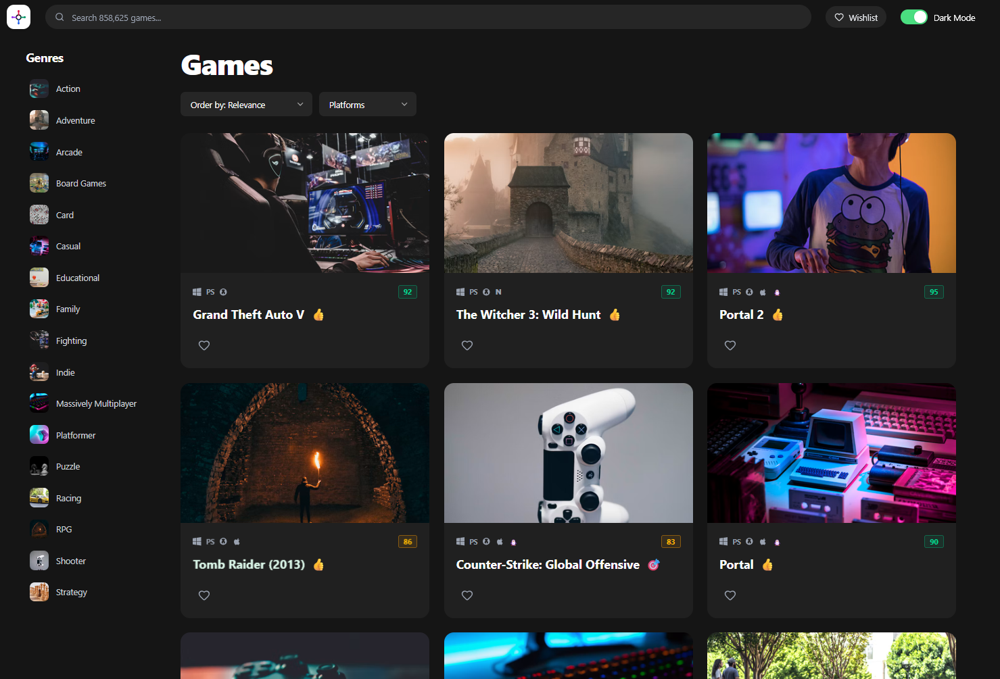

## 1. Verwendete Technologien & Pakete

In diesem React-Projekt übernehmen zwei Hauptpakete das visuelle Design und die Symbole:

### Tailwind CSS (Design & Layout)
Tailwind CSS ist ein sogenanntes **Utility-First CSS-Framework**.
* **Wofür es da ist:** Es sorgt für das gesamte visuelle Aussehen der App – Farben, Abstände, Schriftgrößen, abgerundete Ecken, das 3-Spalten-Raster der Spielekarten und den Dark/Light-Mode.
* **Wie es funktioniert:** Statt eine separate `.css`-Datei zu schreiben und eigene Klassen wie `.game-card` zu definieren, nutzt du fertige kleine Hilfsklassen direkt im JSX (`className="..."`).

**Beispiel aus dem Code:**
```jsx
<div className="rounded-2xl p-5 bg-[#202020] text-white">
```
* `rounded-2xl` = stark abgerundete Ecken
* `p-5` = Innenabstand (Padding)
* `bg-[#202020]` = dunkler Hintergrund
* `text-white` = weiße Schrift

### lucide-react (Symbole & Icons)
`lucide-react` ist eine moderne **Icon-Bibliothek** speziell für React.
* **Wofür es da ist:** Es liefert fertige, scharfe Vektor-Symbole (SVGs), die wie normale React-Komponenten eingebunden werden können.

**Beispiel aus dem Code:**
```jsx
import { Search, Heart, X } from "lucide-react";

// Verwendung im Code:
<Search className="w-4 h-4 text-gray-400" />
<Heart className="w-5 h-5 text-rose-500" />
```
* `<Search />` = Die Lupe in der Suchleiste
* `<Heart />` = Das Herz-Symbol für die Wishlist
* `<X />` = Das Kreuz zum Schließen des Detail-Modals oder Löschen der Suche

---

## 2. Schritt-für-Schritt-Einrichtung mit Vite & Tailwind CSS

Um das Projekt lokal auf deinem Computer einzurichten, führe folgende Schritte im Terminal aus:

### Schritt 1: Neues React-Projekt erstellen
```bash
npm create vite@latest gamehub -- --template react
cd gamehub
```

### Schritt 2: Tailwind CSS & Lucide-Icons installieren
```bash
npm install tailwindcss @tailwindcss/vite lucide-react
```

### Schritt 3: Vite-Konfiguration anpassen
Öffne die Datei **`vite.config.js`** im Hauptverzeichnis und füge das Tailwind-Plugin hinzu:
```javascript
import { defineConfig } from 'vite'
import react from '@vitejs/plugin-react'
import tailwindcss from '@tailwindcss/vite'

export default defineConfig({
  plugins: [
    react(),
    tailwindcss(),
  ],
})
```

### Schritt 4: Tailwind in CSS einbinden
Öffne **`src/index.css`**, lösche den vorhandenen Inhalt und füge diese Zeile ein:
```css
@import "tailwindcss";
```

### Schritt 5: JSX-Code einfügen & Entwicklungsserver starten
1. Füge den React-Code in die Datei **`src/App.jsx`** ein (ersetze den bisherigen Inhalt).
2. Starte die Anwendung im Terminal:
```bash
npm run dev
```
3. Öffne den angezeigten Link (meistens `http://localhost:5173`) in deinem Browser.

Klick auf eine Spielekarte öffnet eine Detailansicht mit Beschreibung, Publisher, Release-Datum und Bewertungen.

